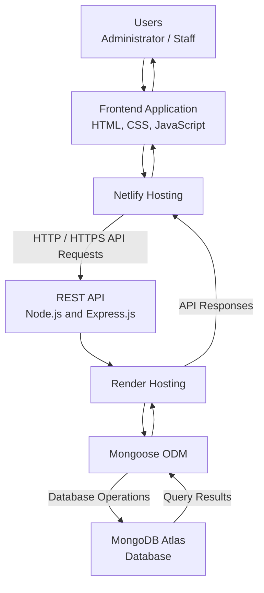
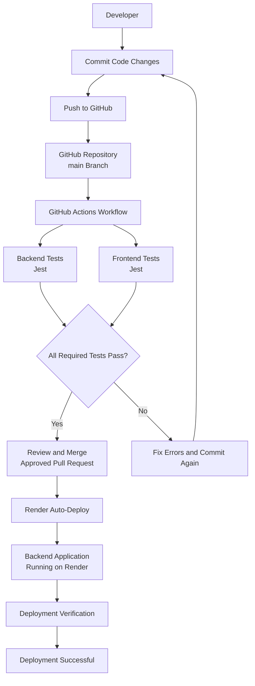

# System Architecture Diagrams

## Bus Ticket Reservation and Booking System

**Client:** Bicol Isarog Transport System, Inc.  
**Course:** IPT 102 – Integrative Programming and Technologies 2  
**Project:** Pre-Final Project  
**SRS Version:** 1.0

---

## Diagram 1: System Architecture Diagram

### Description

The system follows a three-tier client-server architecture consisting of the presentation layer, application layer, and database layer.

- **Presentation Layer:** The frontend provides the user interface using HTML, CSS, and JavaScript. It is hosted on Netlify.
- **Application Layer:** The backend uses Node.js and Express.js to process requests, perform validation, manage authentication, and communicate with the database. It is hosted on Render.
- **Database Layer:** MongoDB Atlas stores system information, including user accounts, trips, bookings, and payment records.

The frontend communicates with the backend through REST API requests over HTTP/HTTPS. The backend communicates with MongoDB Atlas through Mongoose.

### Architecture Diagram



### Main System Components

| Component | Technology | Responsibility |
|---|---|---|
| User Interface | HTML, CSS, JavaScript | Displays system pages and user interactions |
| Frontend Hosting | Netlify | Hosts the frontend application |
| Backend Server | Node.js | Runs the application server |
| API Framework | Express.js | Handles API routes and HTTP requests |
| Database ODM | Mongoose | Manages communication with MongoDB |
| Database | MongoDB Atlas | Stores application data |
| Backend Hosting | Render | Hosts the backend API |

### Main System Process

1. The administrator or staff member opens the frontend application.
2. The frontend sends an API request to the backend.
3. The Express.js server receives and processes the request.
4. Mongoose communicates with MongoDB Atlas when database operations are needed.
5. MongoDB returns the requested data or confirms a database operation.
6. The backend sends an API response to the frontend.
7. The frontend displays the result to the user.

---

## Diagram 2: CI/CD Pipeline Diagram

### Description

The project uses GitHub Actions to automate testing and support continuous integration.

Whenever a developer pushes code or creates a pull request targeting the `main` branch, GitHub Actions runs the backend and frontend test jobs.

The deployment process is configured so that Render deploys the backend after the required CI checks pass.

### CI/CD Pipeline Diagram



### CI/CD Pipeline Stages

| Stage | Process | Description |
|---|---|---|
| 1. Development | Code Changes | Developers modify the frontend or backend source code. |
| 2. Version Control | Git Commit and Push | Changes are committed and pushed to GitHub. |
| 3. Continuous Integration | GitHub Actions | Automatically starts the configured workflow. |
| 4. Backend Testing | Jest | Executes backend automated tests. |
| 5. Frontend Testing | Jest | Executes frontend automated tests. |
| 6. Validation | Test Results | Checks whether the required tests pass. |
| 7. Code Integration | Pull Request | Approved changes are merged into the main branch. |
| 8. Continuous Deployment | Render | Deploys the backend after the required CI checks pass. |
| 9. Verification | Deployment Check | Confirms that the deployed application is responding correctly. |

### CI/CD Configuration

The GitHub Actions workflow is located at:

```text
.github/workflows/ci.yml
```

The backend deployment configuration is located at:

```text
render.yaml
```

The frontend deployment configuration is located at:

```text
netlify.toml
```

---

## Deployment Overview

| Application Component | Hosting Platform | Purpose |
|---|---|---|
| Frontend | Netlify | Hosts the browser-based application |
| Backend | Render | Hosts the REST API |
| Database | MongoDB Atlas | Stores persistent application data |
| Source Code | GitHub | Maintains project source code and version history |
| CI Workflow | GitHub Actions | Runs automated tests |

## Security and Configuration Notes

- Database credentials and other sensitive values must be stored in environment variables.
- The `.env` file must not be committed to the public GitHub repository.
- JWT authentication is used to protect authenticated API operations.
- CORS is configured to allow requests from the designated frontend origin.
- Administrative operations must be restricted to authorized administrators.

---

**Document:** System Architecture and CI/CD Diagrams  
**Project:** Bus Ticket Reservation and Booking System  
**Prepared by:** Jay Rhomer Vidor and Ronelyn Santillan